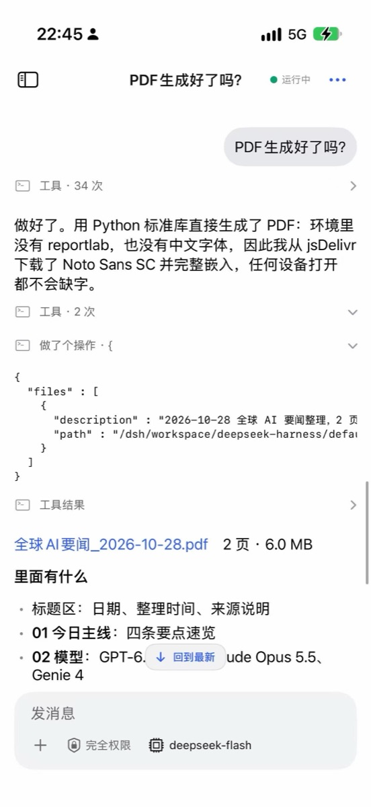

<p align="center"></p>

# Phone DSH — Xiaozhi & Tono AI Team 联合开源

把 DeepSeek Harness 原样跑进 iPhone App。

[English](README.md) · [架构说明](docs/architecture.md) · [协议规范](spec/v1/README.md)

<p align="center"></p>

> 吉祥物是 DeepSeek 助手的同人创作，作为项目形象使用；它不是 DeepSeek 官方素材，也不在 MIT 许可范围内（见 [NOTICE](NOTICE)），本项目与 DeepSeek 官方无隶属关系。


## 这是什么

DeepSeek Harness（DSH）自带 `webworker-runtime`，让 harness 在 Web Worker 里执行。Phone DSH 做的是宿主这一侧：一个 Swift SDK，把 Worker 启动在系统 WebKit（WKWebView）里，并提供手机真正能提供的服务。WebView 保不住的东西都留在 App 进程：日志、回环源、凭据和生命周期。

DSH 版本钉在 [`plugins/dsh-pin.json`](plugins/dsh-pin.json)：`0.2.1-rc.2`，commit `7be5505b0be06009d74891c869063c9cf19a0df0`。DSH 源码树不会被复制、vendor 或修改。Worker 镜像由 `plugins/scripts/pack-image.mjs` 驱动 DSH 检出自带的 packer 库构建，phone-dsh 的插件 staged 在旁边。packer 只规范化两个包里 built `dispose()` 清理调用点各一处；每个位置都有锚点，改写前后的 SHA-256 记进 `sizes.json`，源码边界由 `scripts/ci/no_dsh_patch.py` 守住。

如果没有这层拆分，要么得为手机重写官方 DSH 插件树（模型适配、工具、子代理、会话持久化），要么得让 WebView 承担它保不住的权威。

## 关键特性

- **单一回环源。** 页面、静态资源、镜像与 overlay 分片、有序 WebSocket、`/v1/http` 和 MCP 端点共用同一个 `127.0.0.1` 源。Worker 用普通的同源 `fetch` 和 WebSocket 即可，不需要自定义 URL scheme，也没有第二个服务器。
- **工作区写入是持久的。** 模型做出的每一次改动都带持久 `mseq` 编号写入预写日志，确认后才算持久；重连或重启后，Worker 从最后确认的编号开始重放。一级确认能扛进程被杀；二级确认（epoch 关闭、`F_FULLFSYNC`、原子写 manifest）把 epoch 落到稳定存储，所以断电最多丢最后一个未关闭的 epoch。
- **API key 不进 Worker。** 模型网关按精确的上游 host 与路径向 App 的 `CredentialProvider` 取凭据，在宿主侧注入，并先剥掉入站的 `authorization`、`proxy-authorization` 和 `x-pdsh-*` 头。Worker 手里只有占位符；重定向只有在同一作用域内才会重新带上凭据。
- **生命周期扛得住系统打断。** 在工具调用边界做计划内重启；后台 park/drain/resume，排空窗口 20 秒；内存与温度预算；带持久非秘密 intent 的交接/收回 facade。宿主状态机出错就大声失败，不会悄悄重新放行。
- **自研加速器 xz-shell。** 宿主侧的只读加速器是我们自己的 Rust workspace（`shell/`），不是打包的第三方二进制：ripgrep 兼容搜索、jq 兼容过滤、tree-sitter 解析/查询，以及 `phone`/`ctx` 宿主桥，统一走手写 C ABI（`include/xzshell.h`），链接为 `PDSHShell.xcframework`。同一个 workspace 还产出 Worker 里运行的 WASI jq 引擎。每个命令在构造上只读（mount table 沙箱拒绝 `/dsh/workspace`、`/dsh/home` 之外的一切）、输出有上限、可取消。
- **执行器倒置。** `bash`、`git`、`python3` 和文件工具都在 Worker 内的内存 VFS 上运行，写入就是普通的工作区变更。只有宿主广播过的只读加速器（`rg`、`jaq`/`jq`、`ts-parse`、`ts-query`，以及有 bridge 时的 `phone`/`ctx`）才会跨进 App 进程。

## 架构

```text
┌───────────────────────────────────────────────────┐
│ iPhone app (one process)                          │
│                                                   │
│ Swift host: PhoneDSHHost                          │
│  ├─ LoopbackServer   127.0.0.1, one origin        │
│  ├─ WorkspaceLog     WAL + materialized copy      │
│  ├─ ModelGateway     credentials, SSE, retry      │
│  └─ Controller, WebEngine, ExecProvider           │
│                │                                  │
│                │ loopback HTTP + ordered WS       │
│                ▼                                  │
│ WKWebView (web process)                           │
│  └─ Web Worker                                    │
│      └─ DSH webworker-runtime                     │
│          ├─ in-memory VFS (authority)             │
│          ├─ bash, git, python3, file tools        │
│          └─ capability manifest                   │
└──────────────────────┬────────────────────────────┘
                       │ /v1/http, host-injected key, allow-list
                       ▼
                model provider (DeepSeek, ...)
```

App 与 Worker 在一个源上碰面。页面和静态资源走 HTTP；副作用走一条有序二进制 WebSocket（`VFS`、`EXEC`、`JOURNAL`、`API`、`LIFECYCLE`、`CONSOLE`、`FENCE` 等）；模型与 MCP 流量走 `/v1/http`，这是唯一离开设备的路径。WAL 是恢复日志，不是第二个写者：Worker 运行时，内存 VFS 才是权威。持久化模型、帧契约与失败模式见 [docs/architecture.md](docs/architecture.md)。

## xz-shell

Worker 允许交给 App 进程的加速器，是我们自己的 Rust workspace，位于
[`shell/`](shell/README.md)。Apple 构建里没有生成或拷贝的源码：`pdsh-ffi`
导出手写 C ABI（`shell/include/xzshell.h`，有测试核对导出符号），Swift 宿主
链接 `shell/build-apple.sh` 产出的 `PDSHShell.xcframework`。

| crate | 提供什么 |
|---|---|
| `pdsh-core` | mount table 路径沙箱、只读 VFS、取消、输出上限、资源限制、宿主桥、命令注册表与能力 JSON |
| `pdsh-rg` | `rg`（ripgrep 兼容的只读搜索） |
| `pdsh-jaq` | `jaq` 及 `jq` 别名 |
| `pdsh-ts` | `ts-parse`、`ts-query`（tree-sitter） |
| `pdsh-phone` | `phone`、`ctx` 宿主桥加速器 |
| `pdsh-all` | 宿主实际广播的完整生产注册表 |
| `pdsh-jaq-wasm` | Worker 在 WASI 下运行的 jq 兼容引擎 |

它刻意**不是**通用 shell：`bash -c` 以及一切会写工作区的命令都留在 Worker
里，宿主只广播它真能执行的命令名。可选链接让这条边界保持可见：先
`bash shell/build-apple.sh` 构建，再用 `PDSH_WITH_XZSHELL=1` 链接；没有产物时
SDK 不广播任何加速器能力。

## 快速开始

以下命令默认在仓库根目录执行。

### 环境要求

| 要求 | 说明 |
|---|---|
| Xcode 26、Swift 6.3+ | 记录在案的构建使用 Xcode 26.5 与 Swift 6.3.2 |
| XcodeGen | `brew install xcodegen`；用来重新生成 `examples/probe-app/PhoneDSHProbe.xcodeproj` |
| iOS 17+（SwiftPM 包同时支持 macOS 14） | `project.yml`、`Package.swift` |
| Node.js ≥ 22.19、npm、pnpm | plugins、Worker 镜像、DSH 检出构建 |
| 钉住版本的 DSH 检出 | 本地构建，不入库 |
| Rust stable 与 Apple targets（可选） | 只用于加速器 XCFramework |

### 1. 拉取并钉住 DSH 检出

```bash
export PDSH_DSH_CHECKOUT="$PWD/../deepseek-harness"
git clone https://github.com/deepseek-ai/deepseek-harness "$PDSH_DSH_CHECKOUT"
git -C "$PDSH_DSH_CHECKOUT" checkout 7be5505b0be06009d74891c869063c9cf19a0df0
(cd "$PDSH_DSH_CHECKOUT" && pnpm install --frozen-lockfile && pnpm build)

mkdir -p "$HOME/.config/phone-dsh"
echo "$PDSH_DSH_CHECKOUT" > "$HOME/.config/phone-dsh/dsh-checkout"
(cd plugins && npm ci)
node plugins/scripts/dsh-checkout.mjs --verify
```

`--verify` 会在这些情况下失败：HEAD 与 pin 不一致、跟踪文件被改、packer 会读的路径下出现未跟踪文件，或者构建产物缺失。`PDSH_DSH_CHECKOUT` 优先于机器上的路径文件；这个绝对路径不会进仓库。

### 2. 准备 Worker bundle

`examples/probe-app/Bundle/worker/` 不入库，缺了它宿主会拒绝启动。

```bash
bash scripts/ci/build-web-dist.sh --source "$PDSH_DSH_CHECKOUT" \
  --store /tmp/phone-dsh-pnpm-store
examples/probe-app/scripts/copy-bundle-assets.sh \
  --checkout "$PDSH_DSH_CHECKOUT" --force
```

复制步骤会构建 Worker 镜像，默认把 CPython 与 jq 的 WASI 产物一起打包（要用 `--without-python` / `--without-jq` 显式不要），校验检出与镜像来源一致，并记录 provenance。Web 发行目录放的是完整 DSH 页面，供 Worker 启动使用；App 原生界面不会打开它（完整 Web UI 已移除）。

### 3. 生成并构建 probe App

```bash
cd examples/probe-app
xcodegen generate

# 模拟器
xcodebuild -scheme PhoneDSHProbe \
  -destination 'generic/platform=iOS Simulator' \
  build CODE_SIGNING_ALLOWED=NO

# 真机：先在 project.yml 里把占位 bundle id 换成自己的，再签名。
xcodebuild -scheme PhoneDSHProbe \
  -destination 'generic/platform=iOS' \
  -allowProvisioningUpdates DEVELOPMENT_TEAM=YOUR_TEAM_ID build
```

生成的 `PhoneDSHProbe.xcodeproj` 故意不入库。模拟器报告会标成 `ios-simulator`，不是真机证据。

### 4. 跑门禁

```bash
bash scripts/ci/check.sh --list
bash scripts/ci/check.sh --only phone-plugins,phone-image,phone-sdk
bash scripts/ci/check.sh        # 全部阶段
bash scripts/ci/smoke.sh        # 桌面端，真 WKWebView，脚本模型
bash scripts/ci/sim.sh          # iPhone 17 Pro 模拟器，四份参与判定的 JSON 报告
```

阶段是 `phone-spec`、`phone-plugins`、`phone-image`、`phone-sdk`、`phone-no-dsh-patch`、`phone-hygiene`、`phone-license`、`phone-modules`、`phone-gate-contracts` 和 `phone-xcode-resolve`。可选阶段被跳过时，整轮以 `INCOMPLETE`（exit 2）结束，永远不会是 `PASS`。按 catalog 跑的真实模型批处理单独执行：

```bash
eval "$(node scripts/ci/model-env.mjs)"   # 只导出 PDSH_MODEL_*，不打印密钥
bash scripts/ci/scenarios.sh --upstream real
```

## 仓库结构

| 路径 | 内容 |
|---|---|
| `Sources/PhoneDSH*` | Swift 宿主模块：`Wire`、`Log`（WAL）、`Loopback`、`Gateway`、`Controller`、`Engine`、`Shell`、`AgentCore`，以及门面 `PhoneDSH` |
| `plugins/` | Worker 侧 TypeScript：入口、通道客户端、DSH 插件、手机 profile、镜像打包器、`dsh-pin.json` |
| `spec/v1/` | 宿主/Worker 契约：帧、WAL、exec、交接、预算、golden vectors |
| `shell/` | xz-shell：自研 Rust 只读加速器，构建为 `PDSHShell.xcframework` |
| `examples/probe-app/` | iOS probe App、模拟器套件、真机报告导出 |
| `Tests/` | Swift 单测、探针、kill、smoke、场景套件 |
| `scripts/ci/` | 本地门禁：`check.sh`、`smoke.sh`、`sim.sh`、`scenarios.sh`、`probes.sh` |
| `docs/` | 架构、probe runbook、原生验证记录、功能测试计划 |

## 文档

- [docs/architecture.md](docs/architecture.md)：已实现能力、持久化模型、凭据、预算与已知限制。
- [docs/functional-test-plan-2026-10-28.md](docs/functional-test-plan-2026-10-28.md)：原生界面的测试矩阵。
- [docs/runbook-probe.md](docs/runbook-probe.md)：构建产物、跑 probe 包和 smoke、读报告。
- [spec/v1/README.md](spec/v1/README.md)：规范的宿主/Worker 契约与 golden vectors。
- [CONTRIBUTING.md](CONTRIBUTING.md)：一次改动必须满足的规则。

## 安全与隐私

- **密钥。** SDK 的模型设置存储通过 `KeychainModelProviderSecretStore`（`kSecClassGenericPassword`）把模型凭据放进 Keychain。MCP 请求头值、独立网页搜索密钥、handoff reclaim token 各有专用 Keychain service；每次启动的 loopback token 只留在内存。
- **出网。** 网关允许列表是 `allowedModelHosts` 与 `egressAllowHosts` 的并集；模型 host 列表为空就拒绝所有上游。MCP 授权按精确 `scheme/host/port/path` 发放，不接受 `*`。Worker 从不自己开对外的 socket，所有外部请求都走宿主的 `/v1/http` 并在那里检查。
- **会离开设备的。** 提示词、工具结果和模型请求从手机直接发给你配置的 provider，没有中继服务；你添加的 MCP server 会收到对应请求。工作区、WAL 和会话记录留在 App 容器的 `Library/xl/<workspace_id>/`。示例 App 给 Worker 设置 `DSH_TELEMETRY_DISABLED=1`，本仓库不包含分析或崩溃上报代码。
- **不会离开的。** API key、loopback token、MCP 请求头值、reclaim token 都由宿主注入，Worker 只看得到占位符。MCP 认证头只在精确 URL 上注入，宿主托管的错误正文会脱敏。

本仓库目前没有 `SECURITY.md`。报告漏洞请走 GitHub 的私密安全公告：**Security** → **Report a vulnerability**。不要在公开 issue 里贴 key、token 或利用细节。

## 状态与限制

一条 PASS 只属于其 receipt 中写明的源码 commit、构建产物和环境。本仓库没有当前源码的端到端 gate receipt。

| 范围 | 状态 |
|---|---|
| 桌面 smoke（真 WKWebView + 脚本模型） | 在较早修订上通过的历史门禁；当前源码重跑未记录 |
| iPhone 17 Pro 模拟器门禁（`sim.sh`） | 历史模拟器门禁；只是模拟器证据 |
| 全 56 场景真实模型批跑（`scenarios.sh`） | 当前源码 NOT_RUN；需要真实密钥和绑定源码的 receipt |
| 物理 iPhone（签名、安装、真实 provider、后台） | NOT_RUN；没有真机证据，限流、JIT、jetsam、锁定模式和后台调度在真机上仍是 NOT_VERIFIED |
| 远端 handoff peer | facade 与进程内测试存在；真实传输上的部署 peer NOT_RUN |
| 托管 GitHub Actions | 因账单原因目前关闭，所以不放 CI 徽章；`.github/workflows/ci.yml` 保留，同样的门禁在本地跑 |
| App 里的完整 DSH Web UI | 已移除：App 只保留原生 SwiftUI 界面；Worker 镜像里仍带 DSH 页面，那是 Worker 启动用的，不是界面 |
| 原生加速器 | 可选：`PDSH_WITH_XZSHELL=1` 加构建好的 `shell/dist/PDSHShell.xcframework`；不链接时 SDK 不广播任何能力并大声失败 |
| 锁定模式 | 本地 Worker 不可用并会如实上报，App 内没有绕过办法 |

## 参与贡献

见 [CONTRIBUTING.md](CONTRIBUTING.md)。硬规则：不改 DSH 源码；改契约时 `spec/v1` 与 golden vectors 一起改；每次改动都要让本地门禁保持通过。

## 许可证

MIT，见 [LICENSE](LICENSE)。© 2026 Xiaozhi & Tono AI Team。

Worker 镜像中的第三方组件列在 [plugins/THIRD_PARTY.md](plugins/THIRD_PARTY.md) 与 [shell/THIRD_PARTY.md](shell/THIRD_PARTY.md)。社区项目，与 DeepSeek 官方无隶属或背书关系。
