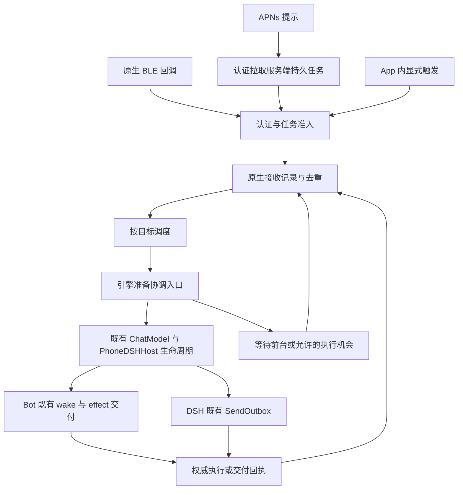

<!-- SPDX-License-Identifier: MIT -->
# iOS 引擎待命与外部任务唤醒架构

状态：**Proposal / 架构评审稿，未实现**。源码基线：`ad6a706c24cc00be62800f8c48705dc3ec0f292c`。
范围：iOS 原生 App、Bot 与本机 DSH；Android 延后。

Protocol impact: none — documentation-only proposal with no normative contract or runtime changes.

本文决定后续实现方向，不是可调用协议。所有新增名称、状态、记录和限额要求均为
设计提议；实施前必须在对应 owning spec 中冻结字段、迁移与共享正反例。

## 1. 决策

App 可以运行时，已启动的引擎保持低活动待命，不按固定空闲时长销毁。
后台任务的可靠性不依赖 WKWebView 永不被回收，而依赖：**原生接单、持久记录、
按条件恢复引擎、依据实际执行回执结算**。

- 保留 1800 秒的运行中回合无事件 watchdog。它处理卡死，不是空闲驻留期限。
- 分离「接收入口是否可用」与「引擎是否已准备执行」，不再用一个 online 布尔值概括。
- 外部任务先经过认证与准入并持久化，再尝试启动/恢复引擎；回收不能抹掉已接收任务。
- 一个 App 侧协调入口复用现有 host 生命周期。不得建立第二套并行 boot/park/rebuild 状态机。
- 不依靠新增 Agent session、旁观模型或额外 LLM 调用管理驻留。
- 不承诺 iOS 后台随时可达；系统不授予执行机会时，任务保持待处理并如实显示原因。

## 2. 当前实现与缺口

| 当前源码 | 已确认行为 | 本方案如何衔接 |
| --- | --- | --- |
| [ChatHostConfiguration](../../examples/probe-app/ProbeKit/ChatHostConfiguration.swift) / [PhoneDSHInactivity](../../Sources/PhoneDSH/PhoneDSHInactivity.swift) | `turnInactivityTimeout=1800`，只监督开放回合；事件续期 | 保留，不能当作 idle TTL 删除 |
| [ChatModel](../../examples/probe-app/PhoneDSHProbe/ChatModel.swift) 的 `scenePhaseChanged` / `finishBackgroundKeepAlive` | 后台无运行任务、近期 routine 或 armed TonoLink 时 park；保活开关默认开启 | 从几个布尔条件演进为有来源、有释放条件的待命需求 |
| [RoutinePresence](../../Sources/PhoneDSHBot/Routines/RoutinePresence.swift) | 近期 routine 窗口为 15 分钟 | 继续作为可解释的需求，不等于保证后台调度 |
| [PhoneDSHHost](../../Sources/PhoneDSH/PhoneDSHHost.swift) 的 `park` / `applyForeground` / `handleTermination` | 已有 drain/resume、单一生命周期 gate；后台 WebContent 终止后恢复意图推迟到前台 | 复用 gate，不因收到远端消息直接绕过后台 boot 限制 |
| [TonoLinkVoiceHost](../../examples/probe-app/PhoneDSHProbe/TonoLinkVoiceHost.swift) / [TonoLinkCtrlBLE](../../Sources/PhoneDSHBLE/TonoLinkCtrlBLE.swift) | 已有 restorable BLE、连接待命及静音音频；语音识别结果目前进入 `ChatModel.send` | 作为第一种外部触发适配器，明确 DSH/Bot 目标，而不是假设已经能投递任意 Bot |
| [SendOutbox](../../examples/probe-app/ProbeKit/Outbox/SendOutbox.swift) | 发送先持久化；以 rpcId 和权威历史回读判定 durable；未知结果不盲重发 | 继续拥有 DSH 发送的交付状态，不用新队列替代它 |
| [WakeInbox](../../Sources/PhoneDSHBot/Wake/WakeInbox.swift) / [BotEffectOutbox](../../Sources/PhoneDSHBot/Journal/BotEffectOutbox.swift) / [BotEffectInbox](../../Sources/PhoneDSHBot/Journal/BotEffectInbox.swift) | 已有 Bot wake、持久 effect、lease、去重与不确定结果处理 | 作为 Bot 下游交付路径；不能直接把不可信外部请求伪装成已授权 wake |
| [BLEDeviceTaskInbox](../../Sources/PhoneDSHBLE/BLEDeviceTaskInbox.swift) / [LANDeviceTaskInbox](../../Sources/PhoneDSHDeviceTasks/LANDeviceTaskInbox.swift) | 已有设备任务 next 拉取与 transport/accept/report 边界，非系统唤醒注册 | 逐条映射各自接收语义，不把 transport accept 当作业务执行完成 |
| [BLESecurePhoneSessionCore](../../Sources/PhoneDSHBLE/SecureSession/BLESecurePhoneSessionCore.swift) | `grantAcceptWindowSeconds=1800` 是设备授权窗口，并有背景/断连等结束条件 | 原样保留；驻留需求不是持续授权，也不能自动续期授权 |
| [Info.plist](../../examples/probe-app/Config/PhoneDSHProbe-Info.plist) | 配置 audio / bluetooth-central / processing / location；本轮未发现 APNs 后台接单接入 | 服务端唤醒属于后续完整接入，不是改超时即可获得 |

没有发现前台空闲 30 分钟就主动销毁引擎的统一定时器。如果设备上出现该现象，必须
用日志区分：回合 watchdog、主动 park、WebContent termination、内存压力、系统挂起、
设备 grant 到期；不能仅按持续时间归因。

## 3. 平台约束

App 进程存在、App 获得 CPU、WebContent 活着、Worker ready、任务已执行是不同事实。

- iOS 通常会挂起后台 App；持有对象引用不能阻止挂起。
- Core Bluetooth 可针对特定待处理蓝牙事件唤醒/恢复 App，不保证任意连接与任意时刻可用。
- 后台 APNs 是低优先级提示，可能延迟、合并或不送达；不能作为唯一任务存储。
- 当前引擎恢复策略要求前台处理 WebContent 重建。本方案首先沿用该规则；若要支持
  原生唤醒窗口内冷启动 WKWebView，必须另立实验、真机证据和契约变更，不能默认放行。
- 锁屏后受保护数据可能不可访问。无法完成持久写入时不能返回「已接收并保存」；
  由服务端/设备保留并重试，或明确报告暂不可接收。不得通过自动解锁或更改数据保护
  等级解决这一架构问题。

Apple 依据（查阅于 2026-11-14）：
[后台执行生命周期](https://developer.apple.com/documentation/uikit/about-the-background-execution-sequence)、
[蓝牙状态恢复条件](https://developer.apple.com/documentation/technotes/tn3115-bluetooth-state-restoration-app-relaunch-rules)、
[后台推送](https://developer.apple.com/documentation/usernotifications/pushing-background-updates-to-your-app)、
[定时器与能耗](https://developer.apple.com/library/archive/documentation/Performance/Conceptual/EnergyGuide-iOS/MinimizeTimerUse.html)。

## 4. 组件与所有权

以下是逻辑职责，不要求为每个方框新增一个 framework 或服务。

| 职责 | 唯一权威与约束 |
| --- | --- |
| 触发适配器 | 只解释各自 transport 和认证来源，不直接执行 prompt、不直接 boot 引擎 |
| 原生接收记录 | 记录已准入请求、目标、去重键、期限和下游关联；不复制对话历史或另建副作用账本 |
| 目标路由 | 接收时固定目标账户、workspace、Bot/DSH 标识；绝不在稍后交付时读取「当前选中会话」替代原目标 |
| 引擎准备协调入口 | 合并同时到达的恢复请求，转交现有生命周期 gate；判断执行资格，不拥有第二套 Host 状态 |
| Bot / DSH 下游 | 分别继续拥有自身授权、排队、rpcId/effectKey、取消与结算语义 |
| 待命需求集合 | 引用计数/lease 记录谁要求待命以及何时释放；不授予工具权限 |
| 诊断与 UI | 展示已经观察到的接收/执行状态及阻塞原因；不把旧心跳当作当前可执行证明 |

### 持久化落点

首选在现有原生 SQLiteDomainStore 的生命周期/事务能力上扩展一张**准入记录**，并让
这部分初始化不依赖 Worker ready。它只拥有外部接收事实与下游关联，不替代
SendOutbox、WakeInbox 或 effect ledger。这个拆分可行性和 schema migration 是 R1 的
实现前置项；本 PR 没有新增表或声称现有 Store API 已支持该记录。

如果具体 Store 的 Bot principal 边界无法自然承载 DSH 目标，必须由 store owner 给出
最小宿主层存储方案及迁移决定；禁止伪造 Bot principal 或悄悄再建一个权威数据库。
**落点未冻结前不得启动持久化实现。**

准入记录需要表达来源、认证主体引用、稳定请求 ID、固定目标、内容摘要/引用及摘要哈希、
到期时间、阶段、下游 rpcId/effectKey、最近错误和重试时间。这些是需求清单，**不是
已冻结的 JSON 字段或新 envelope**。大文件用引用，不把字节塞入唤醒通知或接收记录。

## 5. 两套正交状态

### 引擎可用性

这些名称是 App 的诊断分类，映射既有 Host 状态，不替换 Host 状态机。

| 状态 | 进入依据 | 后续处理 |
| --- | --- | --- |
| 未启动/已释放 | 没有可用 runtime 或确认终止 | 有任务时请求准备；后台不允许 boot 时进入等待 |
| 准备中 | 唯一 boot/resume/rebuild 正在运行 | 后续触发共享准备结果，不再启动一份 Worker |
| 就绪待命 | 真实 ready/连接验证通过，没有执行中的任务 | 前台保留；无意义轮询、可见动画和非必要网络活动停下 |
| 执行中 | 现有运行时报告任务开始 | 保留已有任务保活与回合 watchdog |
| 已暂停 | 主动 park 已完成 | 保留队列，允许时经现有 resume 路径恢复 |
| 恢复受限 | 后台 boot gate、锁屏数据、内存/热状态或失败退避 | 记录可恢复原因；不要立即无限重启 |

### 任务接收与交付

概念状态与现有枚举通过适配器对应，不直接给旧枚举追加新值。

`待准入 → 已持久接收 → 等待执行条件 → 交付中 → 已关联下游 → 执行回执/终态`

旁路：拒绝、到期、用户取消、不确定结果、人工/自动对账。期限与取消在每次交付前
再次检查；取消已经开始的工作使用现有取消接口，不假定能撤销已经发生的副作用。

| 对外表述 | 必须具备的依据 |
| --- | --- |
| 已接收 | 本地准入记录已 durable；仅拿到 BLE 包/HTTP ACK 不够 |
| 已排队 | 存储与目标记录可回读；仍不承诺当前能执行 |
| 已交付 | 下游权威记录确认同一关联 ID；网络 send 返回不够 |
| 已开始 | 引擎/任务拥有者的真实 start |
| 已完成 | 下游权威终态与结果引用；引擎 ready、transport ACK 均不够 |
| 结果待核对 | 发送后中断，无法确定是否已接收或产生副作用 |

## 6. 端到端流程与竞态

1. BLE/服务端入口先验证来源、账户、目标可见性、授权范围、大小与期限。APNs 仅携带
   最小唤醒提示；任务内容从认证接口拉取，通知本身不授予执行权限。
2. 以「认证主体 + 来源身份 + 来源请求 ID」去重，并验证相同 ID 的目标和内容哈希一致。不同内容
   重用 ID 必须拒绝，不能覆盖已接收任务。
3. 原子写入准入记录后才返回 durable 接收回执。后台窗口结束前不能持久化则不确认，
   让上游保留；服务端任务在拿到手机 durable 确认前始终可重投。
4. 根据当前资格请求准备引擎。正在恢复时合并请求；退出前台、内存压力或系统取消时，
   使用现有 gate 取消/延后，不出现 boot 与 park 并发的两套控制器。单个请求到期只
   释放自己的等待，不能取消其他请求共享的准备过程；最后一个需求释放后再由 Host
   按既有规则决定是否终止准备。
5. 交付前重新核对目标存在、授权仍有效和请求未过期。Bot 是否忙、是否允许 steering
   按既有渠道策略决定，不把每个外部请求都当作打断主任务的消息。
6. 在尝试下游交付前持久记录关联 ID；重试始终使用同一 ID。DSH 继续用 SendOutbox 的
   rpcId 与 `user/message.source.rpcId` 回读。Bot 复用已冻结的 request/effect 去重接口；
   若某入口没有这样的权威回读，标为不确定并补契约，不能声称 exactly-once。
7. 交付成功但本地尚未结算即崩溃：恢复后先查询下游，再续记状态。不能因为 lease 过期
   换一个 ID 直接重发。副作用是否能重试继续由既有 effect/授权层决定。
8. 终态回执可重传；记录清理需保留覆盖上游重试期的去重凭据。退出账户、删除目标或
   erasure 必须清除/隔离相应敏感载荷，同时保留不含正文的必要拒重信息，具体保留期
   由隐私与存储契约冻结。

调度必须有队列容量、单请求大小、每次唤醒处理量、并发、恢复次数、退避和总期限上限。
超载拒绝/背压必须可见，不能静默丢弃已经 durable 的任务。具体数值需要 R0 测量和
R1/R4 的发送端协商后冻结，本提案不伪造已验证的预算。

## 7. 待命与耗电策略

| 场景 | 建议策略 |
| --- | --- |
| 前台、引擎已启动、无任务 | 保持就绪待命，不加固定空闲 TTL；没有任务不是销毁理由 |
| 前台冷启动、从未需要引擎 | 允许懒启动；“不回收已就绪引擎”不意味着每次打开 App 都立即加载全部运行时 |
| 后台且任务正在执行 | 复用现有受限保活/执行资格；到期或资格被收回后保存状态、延后/按既有规则中断 |
| 后台且有已授权的设备待命需求 | 有来源地持有待命 lease；蓝牙断开、用户关闭、授权撤销时释放，不能无限隐式保活 |
| 后台无待命需求 | 可以 park；任务接收/上游持久队列不随 Worker 消失 |
| WebContent 被系统回收 | 保留准入记录；标记不可执行，获得执行机会后恢复；不能用旧 ready 继续接收执行 ACK |
| 锁屏数据不可访问 | 不伪报 durable；按已有数据保护策略等待解锁或由上游重投 |
| 强退或系统不给后台时间 | 显示/返回可观察的能力限制；服务端保留任务，不承诺即时执行 |

现有 `SilentAudioKeepAlive` 及其 TonoLink owner 暂时保留原行为。本方案**不把静音音频
扩大为所有空闲引擎永久后台运行的默认机制**。持续音频、蓝牙重连、runtime tick 与
网络心跳都要计入待命成本，不等同于“没有模型调用所以不耗电”。

空闲运行时应收敛的工作：无消费者时的 UI 状态轮询、头像动画、重复全量扫描与无必要
心跳。只保留有明确用途的连接维护、到期检查或系统注册，不以纯定时轮询代替事件通知。

## 8. 实施顺序与验收

| 阶段 | 交付物 | 最小验收 / 退出条件 |
| --- | --- | --- |
| R0 可观测性与真机基线 | 区分 watchdog/park/系统终止；记录接收、ready、dispatch、回读的时间与原因 | 前台/锁屏、插电/电池、BLE连接/断开各测空闲 30/60 分钟；测 App 与可观测 WebContent 的内存、CPU、wakeups、能耗和唤醒延迟。不可观测值标 unknown，不算 0 |
| R1 原生准入持久化 | 冻结存储落点、身份/去重/关联与迁移；不接远端真实任务 | 在每个写入/交付边界注入崩溃；重复、乱序、不同主体同 ID、目标删除、锁屏数据不可读都有真实回归 |
| R2 生命周期准备入口 | single-flight 复用 ChatModel/Host gate、明确 waiting/ready | 多个任务只引发一次恢复；与 scene change、park、WebContent终止、memory pressure 并发无丢单/无限重启；不放宽后台 boot gate |
| R3 TonoLink 端到端 | 显式选择并绑定 Bot 或 DSH 目标，替换依赖“当前聊天”的路由 | 使用真实板子在前台、锁屏、parked、断线重连、WebContent终止后触发；验证 durable 接收、正确目标、实际执行、去重、取消与回执；不能用 ASR 文本收到代替 Bot 已执行 |
| R4 服务端持久队列 + APNs | 认证取任务、重投/确认、必要 entitlement 与 token 生命周期 | 真机后台推送延迟/合并/丢失、断网、进程重启和用户强退；服务器不因推送成功而删除任务；本地过期/撤权任务不执行 |
| R5 待命策略灰度 | 基于测量选择 lease/资源阈值，UI 如实展示能力 | 对照现有策略量化收益与成本；没有真机内存/能耗基线不声称“几乎零成本” |

R0/R1 先落地；R2/R3 通过后才推广设备待命；R4 不依赖手机永久在线。
每阶段独立提交，P09 UI、P03/P06 执行/交付、P07 设备、P18/P25 存储、P26/P27 Bot
相关 owner 按实际触发路径冻结协议。尤其 R4 必须覆盖服务端与客户端，不能只加客户端
字段就宣布有远程唤醒。

所有工程验收目前均为 **NOT_RUN**；本 PR 只有源码核对和文档校验，不是原生构建、
真机驻留、蓝牙冷唤醒或 APNs 交付证据。旧驻留 spike 中的 NOT_RUN 不会在此升级为 PASS。

## 9. 兼容、回滚与上线边界

本 PR 不修改既有行为，无迁移或部署动作。后续实现必须分别冻结：

- 老发送端 → 新接收端、新发送端 → 老接收端的能力协商/明确拒绝；不得把旧 accept
  升格成 durable。没有新协议能力的设备继续原路径，并明确不具备新的可靠性保证。
- 数据库 schema 版本与旧记录解码；新增记录不可被旧版本误执行。降级时的新任务
  保留/导出/暂停策略必须在首次启用前决定，不能靠忽略未知字段丢任务。
- 回滚开关只关闭新准入，不删除已持久任务；按正确协议排空或暂停。开关名称、默认值
  与持久位置在实现阶段冻结，本提案不提前添加配置项。
- 不自动扩大设备 grant、后台权限或持续执行权限；待命开关与操作授权分别管理。

## 10. 本次交付记录

- Base：`ad6a706c24cc00be62800f8c48705dc3ec0f292c`。
- Changed files：仅本架构文档。
- Runtime status：未实现；无应用/SDK/服务端/固件行为变化。
- 文档检查结果见 PR；真机、能耗、模型与端到端测试：NOT_RUN。
