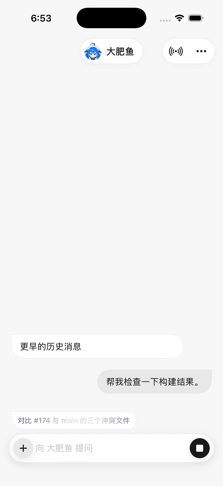
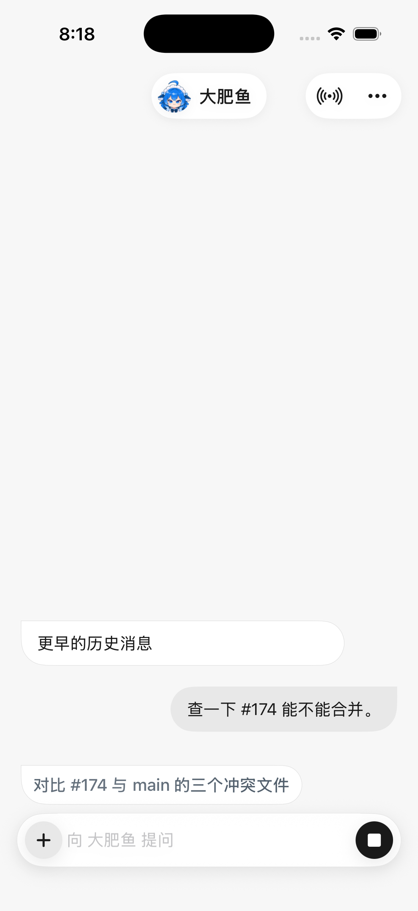
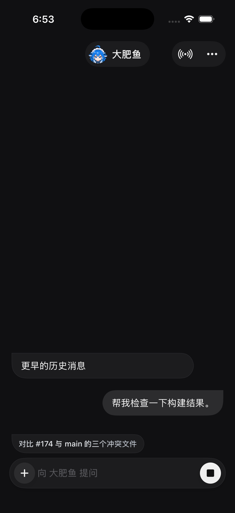
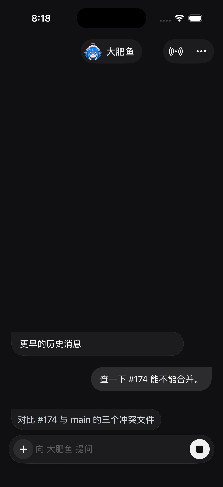
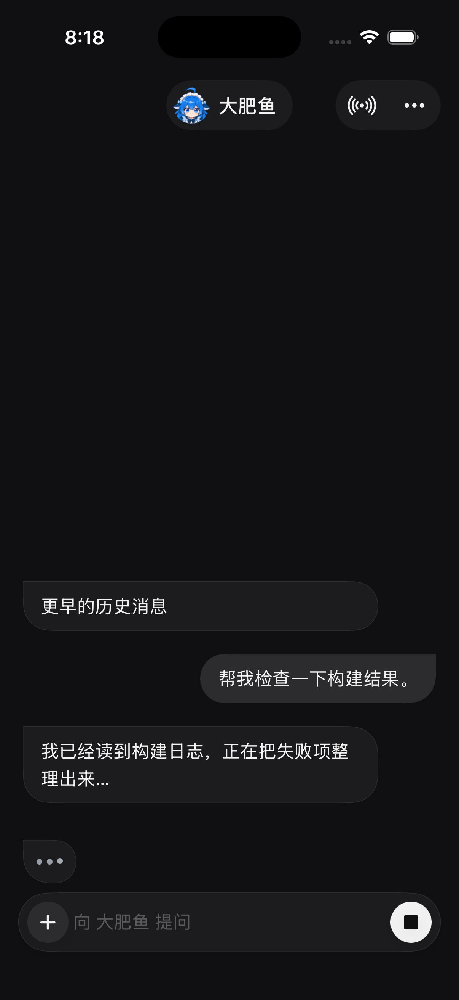

<!-- SPDX-License-Identifier: MIT -->
# Bot iOS 活动气泡验收

本次只调整 Bot 聊天气泡。默认字号从 13pt 提到 16pt，减弱流光，文字切换采用约
220ms 淡化与小幅位移；气泡始终不可点击。等待回应与生成答复只显示三个点，不再
显示「等待响应」「正在回复」。真实任务进展、审批和错误继续显示文字。

- [原生截图对比与动效预览](index.html)（下载后用浏览器打开，或在本地 HTTP 服务中查看）
- [浅色录屏](motion-light.mp4) / [深色录屏](motion-dark.mp4)
- [大字体截图](large-text.png) / [深色错误态](error-dark.png)

| 优化前 | 优化后 |
| --- | --- |
|  |  |
|  |  |

| 等待回应 | 生成答复 |
| --- | --- |
|  |  |

## 已执行

环境：Xcode 26.5 / iOS Simulator 26.5 / iPhone 17。使用现有
`scripts/ci/bot-ui/capture.sh` 的工程装配方式，编译生产 Bot 视图；只选择本次相关
XCUITest。截图是原生渲染，录屏按受控节奏播放真实模型曾产生的短句，用于视觉验收，
不是新模型任务，也不是生产后端或真机测试。

- `PhoneDSHBotUICapture` 构建：PASS。
- `testActivityBubbleCarriesThePresenceSentence`：PASS；正常、审批、失败文案，默认
  38pt 高度及非按钮语义。
- `testActivityChangesKeepComposerAndBandStable`：PASS；三点到进展、长短句切换时，
  输入框和活动槽纵向位置误差不超过 1pt。
- `testActivitySupportsLargerTextAndCrossFadePreference`：PASS；大字体会同时增大
  字号与行框；测试覆盖纯淡化偏好的注入路径。
- `testWaitingAndReplyingUseDotsWithoutPlaceholderWords`：PASS；两种阶段均为点提示，
  原占位文字没有出现在可见静态文字中，气泡没有按钮语义。
- `BotActivityEvidenceTests`：49 项 PASS，包含原 91 条共享向量和新增紧急状态回归。
  审批／失败立即替换旧进展，800ms 队列里的旧句子不会随后重新出现。
- 浅色／深色／大字体／错误态截图已查看；原生动效录像已保存。

最后一轮 UI 命令使用 `xcodebuild ... -scheme PhoneDSHBotUICapture` 并以
`-only-testing:PhoneDSHBotUICaptureUITests/BotCaptureUITests/<上述测试名>` 选择四项；
逻辑回归使用 `xcodebuild -project scripts/ci/bot-activity-evidence/BotActivityEvidence.xcodeproj
-scheme BotActivityEvidenceTests -destination 'platform=iOS Simulator,id=<device>' test`。
该逻辑工程由同目录 `project.yml` 经 `xcodegen generate --spec ...` 生成。

初版动态测试的诊断页脚随长文案换行，导致输入框移动 12pt；最终测试关闭这个仅供调试的
页脚后，在正常产品布局中保留了相同的位置断言。之前编译／测试失败的日志保留，未计为 PASS。

文字配色的 sRGB 计算：正常浅色约 6.44:1，流光最亮处约 4.83:1，正常深色约 10.31:1；
深色错误文字约 5.17:1。这里是颜色对的计算，不是全 App 无障碍认证。实现读取系统
Reduce Motion；本次没有实际切换系统 Reduce Motion 开关，也没有验证 VoiceOver 真机播报。

NOT_RUN：物理 iPhone、真实设备录音／后台、全 App 端到端、Android、部署。
本轮 UI 未重新采样模型：工具／提示词／真实进展投影逻辑沿用已经通过的模型验证，
只修改渲染、字号和显示调度。

## 三个真实 DSH 任务的状态清单

内容基准为 `7ef72269b67641650100df531c09c2cd13450d21`，真实请求均为
`deepseek-official / deepseek-flash / reasoningEffort=max`。使用受控的本地 PR、会议、
邮件资料；邮件只起草，未发送。

按生产投影与计时器回放的非空状态变化计，共 **17 段**：**11 条任务进展**＋**6 段等待／
回复提示**。11 条中 9 条来自主模型的 `activity`／`description`，2 条来自实际工具参数。
最终 UI 将原来这 6 段通用文字映射为三点。此处不是物理屏幕的逐帧曝光统计；快速状态
仍可能被渲染帧或 800ms 最新优先机制合并。

| 任务 | 最终呈现顺序（原样任务文案） |
| --- | --- |
| 检查 #174 | 三点 → 查看工作区与 pr 资料目录 → 读取 #174 的资料笔记 → 读取 main 侧的笔记 → 三点 |
| 总结周三例会 | 三点 → 先看工作区里 notes 资料有哪些 → 在读周三例会纪要原文 → 在读 actions 清单核对待办项 → 三点 |
| 给李光浩写回复草稿 | 三点 → 查看 inbox 和 notes 目录内容 → 在读李光浩的来信内容 → 在读发布背景笔记 → 在写文件 · draft-reply-liguangh… → 打开文档 · 给李光浩的回复草稿 → 三点 |

最后两条「在写文件」「打开文档」由真实文件路径／标题形成，不冒称为主模型专门写出的
活动句。措辞仍可能包含目录名；没有新事实时不会伪造结果，也不承诺每一句都显式包含上一
步的结论。完整模型证据与已知全仓检查失败见 [活动实现记录](../../design/bot-activity-real-projection.md)
和 [机器可读回执](../../../scripts/ci/bot-e2e/activity/receipt.json)。

图片为未改绘的 Simulator PNG；视频只做裁剪起止时间和压缩，未生成或重绘 UI。
资产尺寸与 SHA-256 见 [assets.json](assets.json)。
