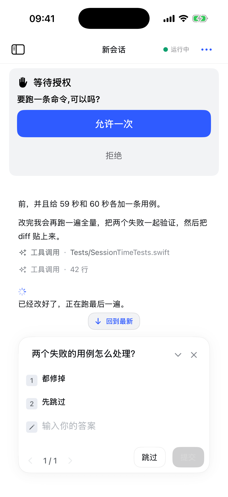
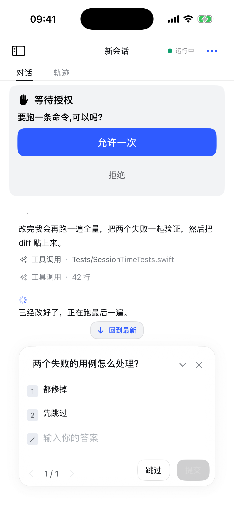
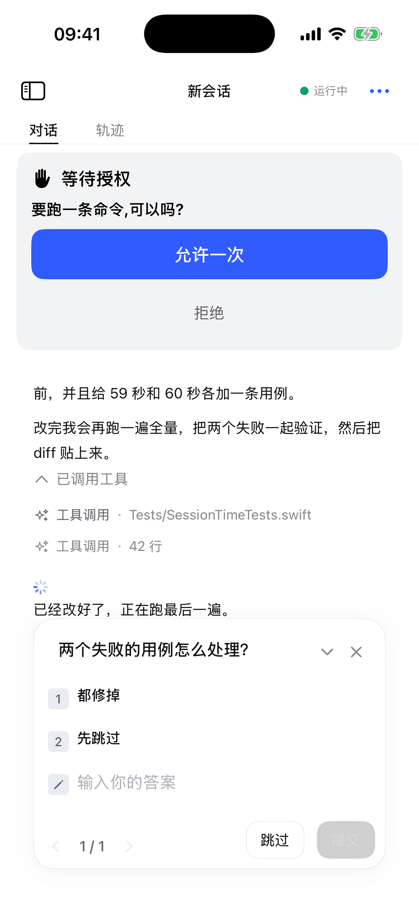
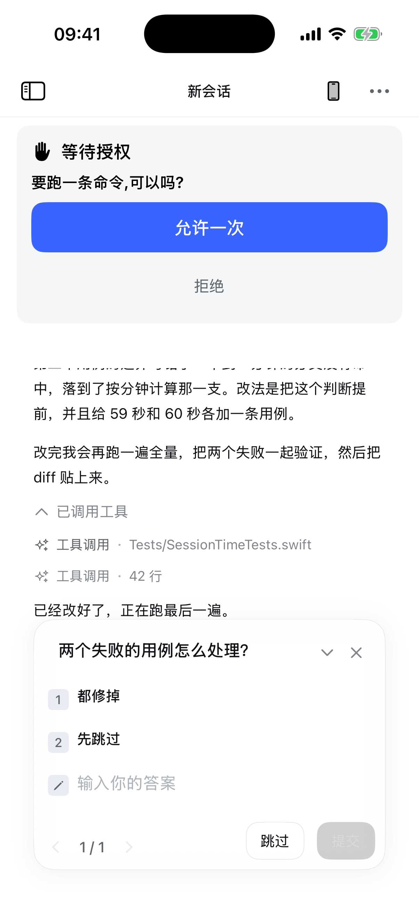

# Wave 0 / 1 实施回执（2026-11-01）

> 计划：[IMPLEMENTATION_PLAN.md](IMPLEMENTATION_PLAN.md)
> 基线：`deepseek-harness 7be5505b0b`，402pt 模拟器（iPhone 16 Pro，1206×2622 px）
> 结论：**地基 + Wave 1/2 的高频 surface 已落地并编译通过**；Turn process、Plan review、Ask card、工具 Details 路由、header 贡献控件已接线；`conversation.view` 按 D-04 产品裁剪不做。

## 1. 并行子 Agent

| Agent | 文件 | 状态 |
|---|---|---|
| WS-B 计划/Todo | `NativeTodoDock` / `NativePlanChip` / `NativePlanReviewCard` / `NativePlanCard` | 已交付，Dock+Chip 已接线；Review/Card 待数据 |
| WS-C 提问 | `NativeQuestionComposer` / `NativeQuestionReplyBubble` / `NativeAskQuestionCard` | 已交付，Composer+Reply 已接线；Ask card 待工具行路由 |
| WS-D Turn | `NativeTurnProcessRow` / `NativeRunningStatus` / `NativeTurnTriggerRow` / `NativeTurnTail` / `NativeProcessGroupHeader` | 已交付，Running+Trigger 已接线 |
| WS-E 子 Agent | `NativeSubagentHeaderButton` / `NativeSubagentCatalogSheet` / `NativeSubagentToolRows` | 已交付，Header+Catalog 已接线；Tool rows 待工具行路由 |
| WS-F 工具 | `NativeToolCardChrome` / `NativeToolDetailsCard` / `NativeToolTitleTable` | 已交付，Title table 已接入 `NativeToolCallModel` |

## 2. 已落地

### 2.1 数据 / 模型

- 修 `session/projections` 两个字段路径：`goal`（去掉 `current` 包裹）、`title`（字符串而非 `{title}`）。
- `HarnessEvent` 新增 `toolResultMeta` / `toolResultErrorCode`；`DSHEventMapper` 从 `tool/result.data.meta`、`error.code` 取值。
- `ChatItem` 新增 `toolErrorCode` / `sourceKind` / `sourceSummary`；历史 projector 与实时 `ChatModel` 同步写入，`interrupted` 归为 `.stopped` 而非 `.error`。
- `ChatModel.projectionValues` 单快照保存 `todos/plan/inbox/userQuestions/subagentCatalog/goal/title`；`todoDockItems`、`planModeState`、`subagentEntries` 从它派生。
- `user/message` + `inbox/spliced` 不再整体丢弃：非 user 来源落为 `sourceKind` 的 context 行，并渲染 turn-trigger；`user-question-reply` 渲染 late-reply bubble。
- `activeTurnStartedAt` 驱动 running clock；`exitPlanMode()` 走 `/plan off` 并刷新 projection。

### 2.2 像素 / token

- 新增 `NativeParityTokens`：官方 405/193 token 的会话线子集（label/bubble/border/code/accent/warn）、14/24、13/24、12/18、11/19、338/370/277、50/33/24、radius 28/20/16/12/8。
- `NativeChatTheme` 改为 facade；用户气泡 `#EDF3FE`/20/10×16/277，正文 14/24，composer 28 圆角 + 16pt 输入 + 338 列 + 32 侧距，页头 50/14-20/0.5pt、标题居中（无轨迹 tab），stats 12/12。
- 402pt 截图：
- 页头 76pt + 对话/轨迹 tab：
- 过程组头（reasoning 已入组；截图为工具组）：
- 页头 more（…）菜单（子 Agent/任务/定时/产物/导出/运行状态/设置/折叠/preset）：

### 2.3 已接线的 surface

- 计划：composer TodoDock / `计划` chip；`intent.kind == "plan-review"` 时 composer 座位渲染 `NativePlanReviewCard`；`exit_plan_mode` 的 `args.plan` 渲染 turn-tail `NativePlanCard`，打开为原生 Markdown sheet。
- composer 底部 stack：Task dock（order 0）→ goal → queue → attachments；gap 6。
- composer 控制行：`计划` chip（plan target 时显示，锁定时禁用，`/plan off`）。
- 转录：`turn-trigger`（10 类来源，展开/折叠）、`question-reply`（右对齐 late answer）、running status（12/22 + divider，12pt gap）。
- 提问：pending question 直接接管 composer 座位（`safeAreaInset(.bottom)`），不再叠在页头卡区；答案序列化为 `{id: selected[] + custom}`；`dismissQuestion()` 只关问题、不动 approval。
- 页头：左抽屉 + 居中标题 + 右侧 Device 图标 + more（…）菜单；子 Agent、后台任务、定时任务、产物、导出、运行状态、本会话设置、折叠时机、preset 全收进菜单；运行中转圈显示在 more（…）上；sidebar-right 也收进菜单。
- Device 固定 session：`ChatModel` 恢复当前 session 时跳过 device mapping，`DSHManagementModel` 从普通 session 列表过滤 mapping，`openManagedSession` 拒绝把 device session 当普通会话打开；真正的只读监视走 Device 页。
- Device 消息来源：`DeviceTranscriptProjection` 按 `source.kind/deviceId/origin` 区分人工与设备；人工消息右侧，设备消息左侧带“设备”标签。设计文档 `docs/design/device-connector-2026-10-31.md` 的 `HarnessCommand.prompt.origin` 仍未接，真实设备上行未实现。
- Device 入口来自个人仓 `sync/personal-mobile-office-20261031` 的 `NativeDeviceEntryIcon`/`NativeDeviceConnectionPage`；当前连接器仍为 nil（页面会明确显示未接入），不伪造在线设备。
- 产物改为 `SessionArtifactsPage`（真实 Office artifact 归属）。
- 行间距验收：transcript flow gap 改为官方 6（process）/12（Assistant response）；ProcessGroupHeader 固定 24pt 行盒、展开 +8；ToolRunRow 去掉 header→body 多加的 6；正文 line box 保持 24（`messageLineSpacing` 随字号计算）。
- 字体/间距：融合 PR11 `NativeMarkdownBody`（段落 20、行距 5、列表 10、`ViewThatFits` 表格网格/卡片）和 `NativeChatTheme` 字体入口；正文字号走 `NativeChatPreferences`，默认 14pt。
- Composer 长尾：本地化命令表/别名/附件拒绝、单一 compaction marker、队列合并 + 单条晋升、UITextView Return/⌘Return/ShiftReturn/Esc/菜单键；详见 [STATUS.md](STATUS.md)。
- 深色：`NativePagePalette` 语义化设置/文件/搜索/模型/插件/计划页；`darkpass-*.png` 11 张证据；sessions drawer 仍强制 light。
- 设置：改为 4 tab（通用/工具/手机权限/关于）；手机权限整页嵌入 tab（无 X/无 intro），PR11 `PhonePermissionsPage`/Requester/Store/23 能力/Info.plist 已接。能力通过 `PhoneCapabilityBridge` + `CompositePhoneToolBridge` 注入 `PDSHShellProvider`，Agent 可消费获授权能力。
- 聊天外观：`NativeChatPreferences` + `ChatPreferencesPage`，设置里可改外观/正文字号/代码字号/折叠时机/转录密度；`busyEnter` 与 `collapseTiming` 同源，页头菜单与设置页联动。默认浅色、正文 14pt，避免破坏 402pt 基线。
- Agent 预设：`agentPreset` projection + `agentPresets/list` 名称映射，页头显示只读 preset 标签；选择器仍在设置页。
- 工具标题：54 key 官方中文 + lsp operation 切换 + aliases，替换旧的 6 条特判；37 个 details key 已路由到 `NativeToolDetailsCard`。
- Turn：`turn/start`/`turn/end` 写入 `turnStartTimes/turnEndReasons/turnEndTimes`（live + history），转录在输入后渲染 33pt 控制行，可折叠到最终回答（所有 eligible closed 轮默认折叠，stopped/failed 保持展开；固定 completion-time 时机）；turn tail 复制有 1s check 反馈，pending 行「发送中…」带 spinner；连续工具调用有分类组头（`NativeProcessGroupHeader`）；动作行已迁到 turn 级 `.turnTail`，锚在整轮所有内容之后。
- 视图 tab：页头 76pt（50 + 26）的「对话 / 轨迹」；轨迹页接 `NativeTrajectoryRow`、刷新与加载更早；轨迹页隐藏 composer。
- 队列：`QueueDock` 第一版，数据来自 `session/projections.inbox`，折叠计数 + lane 标签 + 编辑/设为当前引导/移除。

## 3. 未完成（下一轮）

1. **Turn process / group / turn tail**：控制行第一版已接（live + history 的 `turn/start`/`turn/end` facts → 33pt 已完成/已停止/处理失败 + 16pt 间距，位于输入之后、过程之前），可折叠到最终回答；连续工具调用已有 `NativeProcessGroupHeader`（分类标题/chevron/运行 shimmer）。仍未：最新 exchange 边界细节与折叠动画（中间回复官方本就独立成 response，不进程组）。
2. **Plan review**：已接——`HarnessQuestionItem` 新增 header/detail/intent/approve/callID；`intent.kind == "plan-review"` 时 composer 座位改渲染 `NativePlanReviewCard`，「同意执行」按 approve 标签回答。「要求修改」目前只 `dismissQuestion()`（iOS 无 ASK_CANCELLED waterfall 通道）；「查看全文」未接。
3. ~~**Submitted plan card**~~：已接——turn 收尾助手消息扫描 `exit_plan_mode` 的 `args.plan`，渲染 `NativePlanCard`，点「打开」用原生 Markdown sheet 查看全文。
4. ~~**Ask card**~~：已接——`NativeToolCallModel.askContent` 解析 args/result，`ask_user_question` 工具行展开后走 `NativeAskQuestionCard`；无 JSON 时回退通用 details。
5. ~~**工具 Details 路由**~~：已接第一版——`NativeToolCallModel.detailsModel` 对 37 个 details key 取 args/meta 标量字段 + todo/job 列表，`NativeToolDetails` 优先渲染 `NativeToolDetailsCard`；未覆盖的 shape 仍回退现有专用卡。
6. **`conversation.view` tab**：产品决策 **不做**（D-04）——移动端移除「对话 / 轨迹」tab，页头回到 50pt；轨迹数据/`NativeTrajectoryRow` 保留但无入口。不是 parity 实现。
7. **Header 贡献控件**：`job-list`、`schedule-catalog`、`subagent-catalog`、产物、导出、preset 全部收进统一 more（…）菜单（不再占页头独立键）；`open-in-app` 按 [DECISIONS.md](DECISIONS.md) D-01 为 **N/A**；`sidebar-right` 决策为 `.large` sheet（D-02），`sidebar.right` 入口收进 more（…）菜单；右上为 Device + more 两个键。
8. ~~**Subagent tool rows**~~：已接——`subagent`/`list_agents`/`send_message`/`wait_agent`/`interrupt_agent`/`spawn_teammate` 映射为 `NativeSubagentToolRow`；其余工具仍走通用行。
9. **Composer 队列/图片/命令/压缩**：队列、图片上限、`compaction/summary`、独立 pending 行、键盘发送已接；命令长尾与压缩仍缺。
10. **深色 / Dynamic Type / 官方会话 golden**：官方 402pt hero + auth + 7 个真实会话（含 tool、answered question、approved plan card、subagent×2/turn-trigger）已拿到；聊天外观页已接（外观/字号/折叠/转录密度，默认浅色 14pt 保基线），深色 session/设置/文件/drawer/Sessions 已验；Dynamic Type 未接；官方深色、pending question/Plan review 仍未覆盖。

## 4. 验证

- `swift build --target PhoneDSHAgentCore` ✅
- `xcodegen generate` + `xcodebuild -scheme PhoneDSHProbe -destination 'generic/platform=iOS Simulator' build CODE_SIGNING_ALLOWED=NO` ✅
- iPhone 16 Pro 模拟器安装/启动 `-uiPreview sample` ✅；截图见上。
- 未跑：设备、真实 DSH 回合、官方会话 golden diff、UI 单测（新视图的 preview/typecheck 由子 Agent 做过，但未进 XCTest）。
- 官方 402pt：`scripts/ios-parity/golden/capture-official.sh` 可复现 7 张（hero/auth/session chat/long/tool/question/plan），见 [GOLDEN.md](GOLDEN.md)。
- iOS 402pt 自检：`scripts/ios-parity/capture.sh`。

## 5. 变更文件

新增 32 个 Swift 文件：20 个会话 parity 视图/模型 + PR9 补回的 `NativeChatPreferences`、`ChatPreferencesPage`、`SessionArtifactsPage`、`NativeDeviceConnectionPage`、`NativeDeviceSessionPage`、`NativeDeviceSessionRows`、`NativeDeviceDependencies`、`DeviceTranscriptProjection` + `ProbeKit/Devices/{DeviceConnector,DeviceSessionCoordinator,DeviceSessionMapping,ReadOnlyDeviceSessionTransport}`。

修改 18 个：`AgentHarness`、`DSHEventMapper`、`DSHRemoteHarness`、`ChatModel`、`ChatPage`、`DSHManagementModel`、`NativeChatTheme`、`NativeComposerStats`、`NativeConversationModels`、`NativeToolCallModel`、`NativeToolDetailCards`、`NativeChatTimelineChrome`、`NativeMessageActions`、`NativeTranscriptProjector`、`PhoneDSHInactivity`、`SettingsPage`、`PhoneDSHProbeApp`、`ProbeKit/ChatHostConfiguration`。
